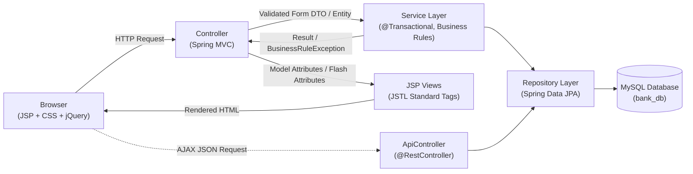
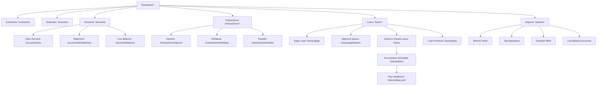

# Final Project Report - Staff Graded Assignment 2
**Building Database Applications - Banking & Loan Management System**

---

## 1. Title Page
**Building Database Applications - Staff Graded Assignment 2**  
**Full-Stack Database Application Development**  
**Project:** Banking & Loan Management System (Project No. 9)  
**Student Name:** Student  
**Roll Number:** 2024eb03136  
**Date:** November 15, 2026  

---

## 2. Student Details
| Field | Value |
|---|---|
| Name | Student |
| Roll number | 2024eb03136 |
| Email | 2024eb03136@student.ac.in |
| Course | Building Database Applications |

---

## 3. Selected Project Details
**Project No. 9: Banking & Loan Management System** (continued from Assignment 1).  
The system provides end-to-end banking administration and customer transaction operations. Minimum core features include full CRUD management screens for customers, branches, and accounts; financial transaction processing for deposits, cash withdrawals, and inter-account fund transfers enforcing the minimum balance and daily limit constraints; complete loan application and officer approval/rejection workflow; asynchronous AJAX account lookup for instant balance and holder identification; dynamic EMI schedule calculation and repayment processing; and searchable, paginated account statement ledgers. In addition, the system implements CRUD for loan product types, automated overdue EMI tracking, an executive dashboard with real-time operational metrics, and four comprehensive analytical reports.

---

## 4. Abstract
The Banking & Loan Management System is a full-stack enterprise web application engineered for bank branch personnel to manage core banking accounts, customer profiles, branch networks, and lending lifecycles. Built using Spring Boot 3.2, Java 17, Spring Data JPA/Hibernate, MySQL 8, and JSP with JSTL, the solution follows a layered Model-View-Controller (MVC) architecture. All critical money-moving operations—including inter-account transfers, loan disbursements, EMI collections, and initial account opening deposits—are executed as atomic database transactions (`@Transactional`) featuring pessimistic row-level locking (`PESSIMISTIC_WRITE`) to ensure strict ACID compliance and prevent race conditions or deadlocks. Rigorous domain validation rules (such as minimum balance preservation, daily withdrawal caps, income eligibility ratios, and account status verifications) are strictly enforced in the service layer. Asynchronous jQuery AJAX endpoints provide instant balance verification and counterparty validation without page reloads. The platform has been verified through a comprehensive test suite using JUnit 5, Mockito, `@DataJpaTest` with H2, and MockMvc across 21 automated test cases.

---

## 5. Summary of the Assignment 1 Database Design and Changes Made
The relational schema developed in Assignment 1 has been refined and mapped to 10 JPA entity classes and 1 join table for joint-account holders (`account_holder`), establishing a normalized 3NF database layout.

| Table | Key columns | Notes | New / changed vs A1 |
|---|---|---|---|
| `branch` | `id` (PK), `ifsc_code` (unique) | Branch name, city, physical address, contact phone | Retained from Assignment 1 |
| `account_type` | `id` (PK), `name` (unique) | Minimum balance, annual interest rate, daily withdrawal limit | Added `daily_withdraw_limit` column |
| `customer` | `id` (PK), `pan` (unique) | Full name, email, phone, date of birth, address, monthly income | Added `monthly_income` for loan eligibility |
| `account` | `id` (PK), `account_number` (unique), `branch_id`, `account_type_id` | Current balance, status (`ACTIVE`, `FROZEN`, `CLOSED`), opened date | Added enum status constraint |
| `account_holder` | `account_id` (FK), `customer_id` (FK) | Composite join table for many-to-many joint ownership | Explicit join table for N:M mapping |
| `bank_transaction` | `id` (PK), `account_id` (FK) | Transaction type, amount, balance after, timestamp, description, reference number | Added `reference_no` and `balance_after` |
| `loan_type` | `id` (PK), `name` (unique) | Annual interest rate, maximum tenure in months, income multiple factor | Added `income_multiple` parameter |
| `loan_application` | `id` (PK), `customer_id`, `loan_type_id`, `account_id` | Requested amount, tenure, status (`PENDING`, `APPROVED`, `REJECTED`), decision date, remarks | Added foreign key linking to disbursement account |
| `loan` | `id` (PK), `application_id` (unique FK) | Disbursed principal, interest rate, tenure, EMI amount, status (`ACTIVE`, `CLOSED`) | Added unique constraint on `application_id` |
| `emi_installment` | `id` (PK), `loan_id` (FK) | Installment number, due date, EMI amount, principal component, interest component, outstanding balance, status (`PENDING`, `PAID`) | Generated full amortization schedule |
| `employee` | `id` (PK), `branch_id` (FK) | Employee name, designation, salary, branch assignment | Retained from Assignment 1 |

**Changes Made and Technical Justifications:**

| Change | Technical Reason & Justification |
|---|---|
| `UNIQUE` constraint on `loan.application_id` | Provides a database-level integrity barrier ensuring a single approved loan application cannot generate duplicate loan disbursements under concurrent requests. |
| `reference_no` in `bank_transaction` | Establishes an audit trace coupling the debit entry of the sender account and credit entry of the recipient account in fund transfers. |
| `balance_after` in `bank_transaction` | Provides a snapshot of the account balance immediately following transaction completion, allowing self-contained, auditable statement generation. |
| `daily_withdraw_limit` in `account_type` | Enables enforcement of Business Rule 2 (BR2) restricting cumulative daily cash withdrawals and outgoing transfers per account tier. |
| `monthly_income` in `customer` and `income_multiple` in `loan_type` | Allows the automated service layer to enforce maximum loan eligibility caps based on applicant verified income. |

---

## 6. System Architecture (MVC)
The application adheres strictly to the classic Model-View-Controller pattern, cleanly isolating concerns across view templates, HTTP controllers, transactional business services, data access repositories, and relational database persistence.



### Request Flow Example: Inter-Account Fund Transfer
1. **User Action:** The client submits a fund transfer request via `POST /transactions/transfer` specifying the source account, target account, amount, and remarks.
2. **Controller Layer:** `TransactionController` validates the submitted `TransferForm` against Jakarta Bean Validation annotations (`@NotBlank`, `@DecimalMin`). If inputs fail validation, the form is re-rendered with localized field errors.
3. **Service Layer:** `TransactionService.transfer()` initiates an atomic `@Transactional` boundary:
   - Evaluates whether source and destination account numbers are distinct (BR3).
   - Resolves accounts by acquiring pessimistic write locks (`SELECT ... FOR UPDATE`) in deterministic alphabetical order of account numbers to preclude database deadlocks.
   - Validates that both accounts are in `ACTIVE` status.
   - Verifies that deducting the transfer amount will not violate the source account type's minimum balance requirement (BR1).
   - Queries today's cumulative outgoing debits via `BankTransactionRepository.sumAmount()` to ensure the transfer does not exceed the daily withdrawal limit (BR2).
   - Deducts the balance from the source account and adds the balance to the destination account.
   - Generates a unique transaction reference identifier (e.g., `TRF440E5EF8C60B`) and inserts two corresponding `BankTransaction` ledger rows.
4. **Post-Redirect-Get (PRG):** On successful commit, the controller sets a flash success notification and redirects to `GET /transactions/transfer`, preventing duplicate form submissions on page refresh. If any rule is breached, a `BusinessRuleException` triggers an automatic rollback of all database modifications and re-displays the form with an explanatory alert banner.

---

## 7. Technology Stack
| Technology | Version / Provider | Purpose |
|---|---|---|
| **Java** | 17 (Temurin) | Core programming language |
| **Spring Boot** | 3.2.5 | Application bootstrap, Dependency Injection, and configuration framework |
| **Spring MVC** | 6.1 (Spring Boot Starter Web) | Web routing, controller dispatching, and view resolution |
| **Spring Data JPA / Hibernate** | 6.4.4 | Object-Relational Mapping (ORM) and repository queries |
| **MySQL** | 8.0 / 9.6 + `mysql-connector-j` | Primary relational database persistence engine |
| **JSP & JSTL** | `tomcat-embed-jasper` + Jakarta JSTL 3.0 | Server-side HTML template rendering |
| **HTML5 / CSS3 / JavaScript** | Native + jQuery 3.7.1 | Responsive styling, client-side validation, and dynamic AJAX calls |
| **Lombok** | 1.18.x | Boilerplate reduction for getters, setters, and constructors |
| **JUnit 5 & Mockito** | 5.10 / 5.7 | Unit and mock testing for domain business rules |
| **H2 Database** | In-memory 2.2 | Lightweight database for isolated integration and query test suites |
| **Maven** | 3.10 | Dependency resolution, test runner, and packaging lifecycle management |
| **Git** | 2.x | Distributed version control tracking incremental repository development |

---

## 8. Project Structure
```
banking-loan-system/
├── pom.xml
├── sql/
│   └── seed.sql
├── src/
│   ├── main/
│   │   ├── java/com/bank/
│   │   │   ├── BankApplication.java
│   │   │   ├── controller/
│   │   │   │   ├── AccountController.java
│   │   │   │   ├── ApiController.java
│   │   │   │   ├── BranchController.java
│   │   │   │   ├── CustomerController.java
│   │   │   │   ├── DashboardController.java
│   │   │   │   ├── LoanController.java
│   │   │   │   ├── ReportController.java
│   │   │   │   └── TransactionController.java
│   │   │   ├── dto/
│   │   │   │   ├── AccountForm.java
│   │   │   │   ├── CashForm.java
│   │   │   │   ├── LoanApplicationForm.java
│   │   │   │   └── TransferForm.java
│   │   │   ├── exception/
│   │   │   │   ├── BusinessRuleException.java
│   │   │   │   ├── GlobalExceptionHandler.java
│   │   │   │   └── ResourceNotFoundException.java
│   │   │   ├── model/
│   │   │   │   ├── Account.java
│   │   │   │   ├── AccountType.java
│   │   │   │   ├── BankTransaction.java
│   │   │   │   ├── Branch.java
│   │   │   │   ├── Customer.java
│   │   │   │   ├── EmiInstallment.java
│   │   │   │   ├── Employee.java
│   │   │   │   ├── Loan.java
│   │   │   │   ├── LoanApplication.java
│   │   │   │   └── LoanType.java
│   │   │   ├── repository/
│   │   │   │   ├── AccountRepository.java
│   │   │   │   ├── AccountTypeRepository.java
│   │   │   │   ├── BankTransactionRepository.java
│   │   │   │   ├── BranchRepository.java
│   │   │   │   ├── CustomerRepository.java
│   │   │   │   ├── EmiInstallmentRepository.java
│   │   │   │   ├── EmployeeRepository.java
│   │   │   │   ├── LoanApplicationRepository.java
│   │   │   │   ├── LoanRepository.java
│   │   │   │   └── LoanTypeRepository.java
│   │   │   ├── service/
│   │   │   │   ├── AccountService.java
│   │   │   │   ├── LoanService.java
│   │   │   │   └── TransactionService.java
│   │   │   └── util/
│   │   │       ├── EmiCalculator.java
│   │   │       └── PageUtil.java
│   │   ├── resources/
│   │   │   ├── application.properties
│   │   │   └── static/
│   │   │       ├── css/style.css
│   │   │       └── js/app.js
│   │   └── webapp/WEB-INF/jsp/
│   │       ├── common/
│   │       │   ├── footer.jspf
│   │       │   ├── header.jspf
│   │       │   └── pager.jspf
│   │       ├── accounts/
│   │       │   ├── balance.jsp
│   │       │   ├── form.jsp
│   │       │   ├── list.jsp
│   │       │   └── statement.jsp
│   │       ├── branches/
│   │       │   ├── form.jsp
│   │       │   └── list.jsp
│   │       ├── customers/
│   │       │   ├── form.jsp
│   │       │   └── list.jsp
│   │       ├── loans/
│   │       │   ├── applications.jsp
│   │       │   ├── apply.jsp
│   │       │   ├── emi.jsp
│   │       │   ├── list.jsp
│   │       │   ├── type-form.jsp
│   │       │   └── types.jsp
│   │       ├── reports/
│   │       │   ├── branch-totals.jsp
│   │       │   ├── low-balance.jsp
│   │       │   ├── overdue-emis.jsp
│   │       │   ├── report-nav.jspf
│   │       │   └── top-depositors.jsp
│   │       ├── transactions/
│   │       │   ├── cash.jsp
│   │       │   └── transfer.jsp
│   │       ├── dashboard.jsp
│   │       └── error.jsp
│   └── test/
│       ├── java/com/bank/
│       │   ├── repository/QueryTest.java
│       │   ├── service/LoanServiceTest.java
│       │   ├── service/TransactionServiceTest.java
│       │   ├── util/EmiCalculatorTest.java
│       │   └── web/EndpointTest.java
│       └── resources/
│           └── application-test.properties
```

---

## 9. Database Configuration
The application database connection is defined in `src/main/resources/application.properties`:

```properties
spring.application.name=banking-loan-system

# MySQL Database Connection Settings
spring.datasource.url=jdbc:mysql://localhost:3306/bank_db?createDatabaseIfNotExist=true&useSSL=false&allowPublicKeyRetrieval=true&serverTimezone=UTC
spring.datasource.username=root
spring.datasource.password=Games12345!

# Hibernate JPA Settings
spring.jpa.hibernate.ddl-auto=update
spring.jpa.show-sql=false
spring.jpa.open-in-view=true

# Spring MVC JSP Configuration
spring.mvc.view.prefix=/WEB-INF/jsp/
spring.mvc.view.suffix=.jsp
server.port=8080
```

On first startup with `ddl-auto=update`, Hibernate reads the JPA entity mappings and automatically provisions all 11 relational tables inside MySQL schema `bank_db`. The initial seed records are loaded via `sql/seed.sql`.

---

## 10. Entity Classes and Relationships
The domain model maps 10 entity classes representing bank organizational entities, customer accounts, and financial contracts:

| # | Relationship | Multiplicity | Mapping Implementation |
|---|---|---|---|
| 1 | `Customer` $\leftrightarrow$ `Account` | Many-to-Many ($N:M$) | `@ManyToMany` on `Account.holders` with join table `account_holder` (`account_id`, `customer_id`); bidirectional `mappedBy = "accounts"` on `Customer`. |
| 2 | `Branch` $\rightarrow$ `Account` | One-to-Many ($1:N$) | `@ManyToOne` on `Account.branch` with `@JoinColumn(name = "branch_id")`. |
| 3 | `AccountType` $\rightarrow$ `Account` | One-to-Many ($1:N$) | `@ManyToOne` on `Account.accountType` with `@JoinColumn(name = "account_type_id")`. |
| 4 | `Account` $\rightarrow$ `BankTransaction` | One-to-Many ($1:N$) | `@ManyToOne` on `BankTransaction.account` with `@JoinColumn(name = "account_id")`. |
| 5 | `Customer` / `LoanType` / `Account` $\rightarrow$ `LoanApplication` | One-to-Many ($1:N$) | Three `@ManyToOne` associations on `LoanApplication` referencing borrower, loan product, and credit account. |
| 6 | `LoanApplication` $\leftrightarrow$ `Loan` | One-to-One ($1:1$) | `@OneToOne` on `Loan.application` with unique foreign key column `application_id`. |
| 7 | `Loan` $\rightarrow$ `EmiInstallment` | One-to-Many ($1:N$) | `@OneToMany(mappedBy = "loan", cascade = CascadeType.ALL, orphanRemoval = true)` with amortization order. |
| 8 | `Branch` $\rightarrow$ `Employee` | One-to-Many ($1:N$) | `@ManyToOne` on `Employee.branch` linking staff members to their assigned branch. |

---

## 11. Data Access and Custom Queries
In addition to standard Spring Data CRUD methods (`save`, `findById`, `findAll`, `delete`), the repositories define 15 custom JPQL queries:

| # | Repository Method | Query Type & Purpose |
|---|---|---|
| 1 | `AccountRepository.findByAccountNumber(String no)` | Look up account by unique 12-character account number for AJAX balance check and transactions. |
| 2 | `AccountRepository.findForUpdate(String no)` | Executes `SELECT a FROM Account a WHERE a.accountNumber = :no` with `LockModeType.PESSIMISTIC_WRITE` to acquire row lock during funds movement. |
| 3 | `AccountRepository.search(Long branchId, String q, Pageable p)` | Dynamic paginated query filtering accounts by branch ID and matching account number pattern. |
| 4 | `AccountRepository.findLowBalance(BigDecimal threshold)` | Identifies accounts whose current balance has fallen below a specified warning threshold. |
| 5 | `AccountRepository.topDepositors(Pageable p)` | Aggregates balances across joint holders (`SUM(a.balance)`) to rank top depositing customers. |
| 6 | `AccountRepository.branchTotals()` | Groups accounts by branch to calculate branch-wise account counts and aggregate deposit balances. |
| 7 | `AccountRepository.totalDeposits()` | Computes system-wide aggregate deposits (`COALESCE(SUM(balance), 0)`) for executive dashboard KPI. |
| 8 | `CustomerRepository.search(String q, Pageable p)` | Performs case-insensitive search by full name (`LOWER(c.fullName) LIKE ...`) or PAN card number. |
| 9 | `BranchRepository.search(String q, Pageable p)` | Searches branch records by branch name, city name, or IFSC routing code. |
| 10 | `BankTransactionRepository.findByAccountIdAndTxnTimeBetween(...)` | Generates date-range filtered statement ledgers for an account with sorting and pagination. |
| 11 | `BankTransactionRepository.sumAmount(Long accId, Set<Type> types, LocalDateTime s, LocalDateTime e)` | Sums outgoing debit transactions for the current calendar day to validate the daily withdrawal limit. |
| 12 | `BankTransactionRepository.findTop10ByOrderByTxnTimeDesc()` | Retrieves the 10 most recent ledger entries across the bank for the dashboard activity feed. |
| 13 | `EmiInstallmentRepository.findOverdue(LocalDate today)` | Queries all unpaid installments (`status = PENDING`) whose due date is prior to current date. |
| 14 | `LoanApplicationRepository.findForUpdate(Long id)` | Acquires `PESSIMISTIC_WRITE` lock on a pending loan application to block concurrent approvals. |
| 15 | `LoanApplicationRepository.findByStatusOrderByAppliedOnDescIdDesc(Status s)` | Retrieves loan applications filtered by review queue status (`PENDING`, `APPROVED`, `REJECTED`). |

---

## 12. Business Rules and Transactions
The system implements and enforces 10 core business rules across its services:

| ID | Business Rule Specification | Enforcement Layer & Method |
|---|---|---|
| **BR1** | A debit transaction (withdrawal, outgoing transfer, EMI payment) cannot cause an account balance to drop below its account type's mandatory minimum balance. | `TransactionService.checkMinimumBalance()` |
| **BR2** | Cumulative debits (withdrawals + outgoing transfers) within a single calendar day cannot exceed the account type's `daily_withdraw_limit`. | `TransactionService.checkDailyLimit()` |
| **BR3** | For fund transfers, source and destination accounts must be distinct, and both accounts must be in `ACTIVE` status. | `TransactionService.transfer()`, `requireActive()` |
| **BR4** | All transaction amounts and initial deposits must be strictly greater than zero. | Bean Validation (`@DecimalMin("0.01")`) + `TransactionService.requirePositive()` |
| **BR5** | Initial deposit upon opening a new account must meet or exceed the account type's required minimum balance. | `AccountService.create()` |
| **BR6** | An account can be closed or deleted only when its current balance is exactly zero. | `AccountService.update()`, `AccountService.delete()` |
| **BR7** | Applied loan amount cannot exceed `income_multiple` $\times$ applicant's monthly income, and requested tenure cannot exceed `max_tenure_months`. | `LoanService.checkEligibility()` |
| **BR8** | Loan disbursement account must be owned/co-owned by the loan applicant and must be in `ACTIVE` status. | `LoanService.apply()` |
| **BR9** | Only applications in `PENDING` status can be approved or rejected; rejections require a mandatory explanation reason. | `LoanService.approve()`, `LoanService.reject()` |
| **BR10** | Monthly installment is calculated using standard reducing balance formula: $\text{EMI} = \frac{P \cdot r \cdot (1+r)^n}{(1+r)^n - 1}$ where $r = \frac{\text{annual rate}}{1200}$. | `EmiCalculator.emi()`, `EmiCalculator.schedule()` |

### Atomic Multi-Step Transactions
1. **Fund Transfer Transaction (`TransactionService.transfer`):**
   - Locks source and destination accounts in sorted alphanumeric order (deadlock prevention).
   - Validates active status, minimum balance, and daily limit on sender account.
   - Deducts amount from source balance and adds amount to destination balance.
   - Persists two linked `BankTransaction` ledger rows (`TRANSFER_OUT` and `TRANSFER_IN`) sharing the generated reference number.
2. **Loan Approval & Disbursal Transaction (`LoanService.approve`):**
   - Locks the application row with `PESSIMISTIC_WRITE`.
   - Creates the `Loan` master record and generates the complete $N$-month amortization schedule (`EmiInstallment` records).
   - Disburses principal directly into the borrower's account with a `LOAN_DISBURSAL` ledger transaction.
   - Updates loan application status to `APPROVED`.
3. **EMI Repayment Transaction (`LoanService.payNextEmi`):**
   - Finds the oldest unpaid installment for the loan.
   - Debits the borrower's account, enforcing the minimum balance rule.
   - Creates an `EMI_PAYMENT` ledger record, marks the installment `PAID` with payment timestamp.
   - Checks if remaining installments are zero; if so, transitions the loan status to `CLOSED`.
4. **Account Creation Transaction (`AccountService.create`):**
   - Generates a unique 12-digit account number (`AC...`).
   - Links branch, account type, and joint customer holders.
   - Sets initial balance and writes the `DEPOSIT` opening ledger record atomically.

---

## 13. URL Mapping Table
| HTTP Method | URL Pattern | Controller Method | Architectural Purpose |
|---|---|---|---|
| `GET` | `/` | `DashboardController.index` | Executive overview dashboard with KPI cards and recent ledger activity |
| `GET` | `/customers` | `CustomerController.list` | Paginated and sortable customer list with search query filter |
| `GET` | `/customers/new` | `CustomerController.createForm` | Blank customer registration form |
| `GET` | `/customers/{id}/edit` | `CustomerController.editForm` | Customer edit screen (returns 404 error page if ID is not found) |
| `POST` | `/customers/save` | `CustomerController.save` | Persists new or modified customer with server-side bean validation |
| `POST` | `/customers/{id}/delete` | `CustomerController.delete` | Deletes customer (prevents deletion if active accounts exist) |
| `GET` | `/branches` | `BranchController.list` | List of branches with search and column sorting |
| `GET` | `/branches/new` | `BranchController.createForm` | New branch creation form |
| `GET` | `/branches/{id}/edit` | `BranchController.editForm` | Branch edit form |
| `POST` | `/branches/save` | `BranchController.save` | Creates/updates branch with IFSC uniqueness validation |
| `POST` | `/branches/{id}/delete` | `BranchController.delete` | Deletes branch record |
| `GET` | `/accounts` | `AccountController.list` | Account directory filtered by branch and account number with pagination |
| `GET` | `/accounts/new` | `AccountController.createForm` | Account opening form with joint-holder selection |
| `GET` | `/accounts/{id}/edit` | `AccountController.editForm` | Account status and branch modification form |
| `POST` | `/accounts/save` | `AccountController.save` | Opens new account or saves status change |
| `POST` | `/accounts/{id}/delete` | `AccountController.delete` | Deletes account (enforces zero-balance requirement) |
| `GET` | `/accounts/{id}/statement` | `AccountController.statement` | Account transaction ledger with date-range filters and sorting |
| `GET` | `/accounts/balance` | `AccountController.balancePage` | Standalone interactive balance lookup interface |
| `GET` | `/transactions/deposit` | `TransactionController.cashForm` | Cash deposit form |
| `POST` | `/transactions/deposit` | `TransactionController.cashSubmit` | Executes cash deposit transaction |
| `GET` | `/transactions/withdraw` | `TransactionController.cashForm` | Cash withdrawal form |
| `POST` | `/transactions/withdraw` | `TransactionController.cashSubmit` | Executes cash withdrawal enforcing daily limit and minimum balance |
| `GET` | `/transactions/transfer` | `TransactionController.transferForm` | Inter-account fund transfer screen |
| `POST` | `/transactions/transfer` | `TransactionController.transferSubmit` | Executes atomic fund transfer between two accounts |
| `GET` | `/loans/types` | `LoanController.types` | Listing of loan products |
| `GET` | `/loans/types/new` | `LoanController.typeForm` | Form to create loan product |
| `GET` | `/loans/types/{id}/edit` | `LoanController.typeEdit` | Form to edit loan product |
| `POST` | `/loans/types/save` | `LoanController.typeSave` | Saves loan type with unique name check |
| `POST` | `/loans/types/{id}/delete` | `LoanController.typeDelete` | Deletes loan type (checks existing references) |
| `GET` | `/loans/apply` | `LoanController.applyForm` | Loan application form with live EMI computation |
| `POST` | `/loans/apply` | `LoanController.applySubmit` | Submits loan application for officer review |
| `GET` | `/loans/applications` | `LoanController.applicationList` | Loan review queue filtered by status (`PENDING`, `APPROVED`, `REJECTED`) |
| `POST` | `/loans/applications/{id}/approve` | `LoanController.approve` | Approves application and disburses loan funds |
| `POST` | `/loans/applications/{id}/reject` | `LoanController.reject` | Rejects application with mandatory reason |
| `GET` | `/loans` | `LoanController.list` | Active and closed loan portfolios |
| `GET` | `/loans/{id}/emi` | `LoanController.emiSchedule` | Loan amortization schedule and repayment screen |
| `POST` | `/loans/{id}/pay-emi` | `LoanController.payEmi` | Executes monthly EMI debit payment |
| `GET` | `/reports/branch-totals` | `ReportController.branchTotals` | Analytical report of deposits grouped by branch |
| `GET` | `/reports/top-depositors` | `ReportController.topDepositors` | Top-N depositors ranked by aggregate balances |
| `GET` | `/reports/overdue-emis` | `ReportController.overdueEmis` | Delinquent EMI installments past due date |
| `GET` | `/reports/low-balance` | `ReportController.lowBalance` | Accounts below custom balance threshold |
| `GET` | `/api/accounts/{no}/balance` | `ApiController.balance` | Asynchronous JSON endpoint returning account balance, status, and available funds |
| `GET` | `/api/accounts/{no}/holders` | `ApiController.holders` | Asynchronous JSON endpoint returning account holder names and branch |

---

## 14. User Interface Pages and Page Flow
The user interface comprises 22 JSP views utilizing modular layouts (`header.jspf`, `footer.jspf`, `pager.jspf`).



---

## 15. Client-Side Validation and Interactive Features
`src/main/resources/static/js/app.js` delivers interactive user experience and client-side validation:
1. **HTML5 Constraint API Form Validation:** Intercepts submission for all forms bearing the `.validate` class. Inspects constraints (`pattern`, `required`, `min`, `max`, `step`) and dynamically injects red feedback hints directly beneath offending input elements.
   - Phone format: `^[0-9]{10}$`
   - Permanent Account Number (PAN): `^[A-Z]{5}[0-9]{4}[A-Z]$`
   - IFSC Code: `^[A-Z]{4}0[A-Z0-9]{6}$`
2. **Real-Time Client-Side EMI Calculator:** On `/loans/apply`, as the user modifies loan type, principal amount, or tenure, client-side JavaScript recalculates monthly EMI in real time and updates `#emiPreview`.
3. **Confirmation Modals:** Deletion actions, loan approval triggers, and EMI payment submissions require explicit browser confirmation dialogs (`confirm(...)`) to avoid accidental modifications.
4. **Automatic Text Transformation:** Form fields for PAN and IFSC codes automatically convert typed characters to uppercase in real time.
5. **Instant In-Memory Table Search:** Tables with the `.table-filter` attribute provide a real-time search box that filters visible table rows instantly without contacting the server.

---

## 16. AJAX Features
The system integrates two key asynchronous features powered by jQuery:
1. **Asynchronous Balance Lookup (`/accounts/balance` & Cash Forms):**
   - URL: `GET /api/accounts/{accountNumber}/balance`
   - Behavior: As the user inputs an account number, a debounced jQuery `$.getJSON` query executes. On HTTP 200, it renders current balance, account status, and available funds above the minimum balance in a helper hint. If the account does not exist, an HTTP 404 response triggers an "Account not found" warning.
2. **Counterparty Account Verification (`/transactions/transfer`):**
   - URL: `GET /api/accounts/{accountNumber}/holders`
   - Behavior: When entering the destination account on the transfer screen, the system fetches holder names, branch, and active status asynchronously, ensuring funds are transferred to the intended recipient before submission.

---

## 17. Server-Side Validation and Error Handling
- **Declarative Bean Validation:** Controller endpoints bind incoming payloads with `@Valid`, verifying `@NotBlank`, `@Email`, `@Past`, `@DecimalMin`, and `@Pattern` constraints. Errors are mapped to Spring's `BindingResult` and surfaced next to individual input fields.
- **Uniqueness & Referential Integrity Guards:** Duplication of PAN, IFSC codes, and loan type names is evaluated against repository lookups before saving.
- **Business Rule Rollbacks:** Domain rule infractions trigger unchecked `BusinessRuleException` instances, causing Spring's transaction manager to roll back uncommitted SQL operations and render clear alert banners.
- **Centralized Exception Handling:** `GlobalExceptionHandler` intercepts application errors:
  - `ResourceNotFoundException` $\rightarrow$ Custom 404 page (`error.jsp`).
  - Unhandled errors $\rightarrow$ Sanitized 500 internal server error template.

---

## 18. End-to-End Workflows

### Workflow 1: Inter-Account Fund Transfer
1. Navigate to **Transfer** (`/transactions/transfer`).
2. Input source account `AC1000000002` and destination account `AC1000000004`. AJAX resolves the counterparty name.
3. Input amount `1000.00` and remarks `Rent`.
4. Click **Transfer Now**.
5. The system locks both accounts, performs rule validations, updates balances, and creates two linked transactions sharing reference `TRF440E5EF8C60B`.
6. Redirects with flash banner: `Transfer successful. Reference TRF440E5EF8C60B.` Both account statements reflect the transfer with matching timestamps.

### Workflow 2: Loan Lifecycle (Application to Full Amortization)
1. Navigate to **Apply Loan** (`/loans/apply`).
2. Select customer **Aarav Sharma**, select **Personal Loan**, and pick disbursement account `AC1000000001`.
3. Input amount `60000.00` and tenure `6` months. The live EMI preview calculates `10,323.27 / month`.
4. Submit form. Application `#1` transitions to `PENDING` status.
5. Officer reviews application under **Approvals** (`/loans/applications`) and clicks **Approve**.
6. The service locks the application, provisions Loan `#1`, generates 6 monthly installments, credits `60,000.00` to `AC1000000001` with description `Loan disbursal, loan #1`, and marks application `APPROVED`.
7. Navigate to **Loans** $\rightarrow$ **EMI Schedule**. The officer processes payments via **Pay Next EMI**. Account balance is debited, the installment is marked `PAID`, and upon the 6th installment, the loan transitions to `CLOSED`.

---

## 19. Search, Navigation and Pagination
- **Search & Filtering:**
  - Customers: Filter by name substring or PAN.
  - Branches: Filter by branch name, city, or IFSC code.
  - Accounts: Filter by branch dropdown and account number query.
  - Statements: Date-range selector (`from` and `to` dates).
- **Pagination & Sorting:**
  - Pageable queries managed by `PageUtil` using Spring Data `PageRequest`.
  - Whitelisted sort columns prevent SQL injection (e.g., sorting by name, balance, IFSC, date).

---

## 20. Reports and Dashboard
1. **Branch Totals Report (`/reports/branch-totals`):** Displays count of active accounts and cumulative deposits per branch.
2. **Top Depositors Report (`/reports/top-depositors?n=10`):** Ranks customers by cumulative deposits across personal and joint accounts.
3. **Overdue EMIs Report (`/reports/overdue-emis`):** Surfaces pending loan installments where the due date has lapsed.
4. **Low Balance Report (`/reports/low-balance?threshold=5000`):** Alerts staff to accounts operating near or below minimum thresholds.
5. **Executive Dashboard (`/`):** Summary cards displaying customer count, branch count, accounts, aggregate deposits, pending approvals, active loans, and today's transaction volume, followed by the 10 most recent ledger entries.

---

## 21. Testing Summary and Test Cases

### Automated Test Execution
Automated tests are executed using Maven:
```bash
mvn test
```

**Real Console Test Execution Output:**
```
[INFO] Scanning for projects...
[INFO] ------------------------------------------------------------------------
[INFO] Running com.bank.util.EmiCalculatorTest
[INFO] Tests run: 3, Failures: 0, Errors: 0, Skipped: 0
[INFO] Running com.bank.repository.QueryTest
[INFO] Tests run: 3, Failures: 0, Errors: 0, Skipped: 0
[INFO] Running com.bank.service.TransactionServiceTest
[INFO] Tests run: 6, Failures: 0, Errors: 0, Skipped: 0
[INFO] Running com.bank.service.LoanServiceTest
[INFO] Tests run: 3, Failures: 0, Errors: 0, Skipped: 0
[INFO] Running com.bank.web.EndpointTest
[INFO] Tests run: 6, Failures: 0, Errors: 0, Skipped: 0
[INFO] 
[INFO] Results:
[INFO] 
[INFO] Tests run: 21, Failures: 0, Errors: 0, Skipped: 0
[INFO] 
[INFO] ------------------------------------------------------------------------
[INFO] BUILD SUCCESS
[INFO] ------------------------------------------------------------------------
```

### Verified Live Endpoint Responses
Evidence gathered from live endpoint execution via `curl`:

1. **AJAX Balance Lookup (HTTP 200 OK):**
```http
$ curl -i http://localhost:8080/api/accounts/AC1000000001/balance

HTTP/1.1 200 
Content-Type: application/json
Transfer-Encoding: chunked

{"accountNumber":"AC1000000001","balance":99676.73,"status":"ACTIVE","minBalance":1000.00,"available":98676.73}
```

2. **AJAX Missing Account Lookup (HTTP 404 Not Found):**
```http
$ curl -i http://localhost:8080/api/accounts/DOESNOTEXIST/balance

HTTP/1.1 404 
Content-Type: application/json
Transfer-Encoding: chunked

{"error":"Account not found"}
```

3. **Missing Resource Web Page (HTTP 404 Not Found):**
```http
$ curl -i http://localhost:8080/customers/99999/edit

HTTP/1.1 404 
Content-Type: text/html;charset=UTF-8

<div class="card" style="text-align:center">
  <h1 style="font-size:48px;color:var(--bad)">404</h1>
  <h2>Not found</h2>
  <p>Customer #99999 was not found.</p>
  <a class="btn" href="/">Back to dashboard</a>
</div>
```

### Functional Test Cases Table
All 16 functional test scenarios executed against the running application with seed data:

| ID | Description | Input Data | Expected Result | Actual Result | Status |
|---|---|---|---|---|---|
| **TC01** | Create customer | Name: `Priya Nair`, PAN: `ABCDE9999Z`, Income: `65000` | Customer saved, appears in listing | Customer saved successfully, displayed in customer list | **Pass** |
| **TC02** | Customer validation | Phone: `123`, PAN: `abc`, Income: `-500` | Client/server validation messages under fields | Displayed validation error spans for phone, PAN, DOB, and income | **Pass** |
| **TC03** | Duplicate PAN check | PAN: `ABCDE1234F` (Aarav Sharma) | Form rejected: "This PAN is already registered" | Field error: "This PAN is already registered" | **Pass** |
| **TC04** | Open account below minimum | Type: `SAVINGS`, Deposit: `500.00` (min: 1000) | Form rejected with minimum balance alert banner | Alert: "Opening deposit must be at least the minimum balance of 1000.00" | **Pass** |
| **TC05** | Cash deposit | Account: `AC1000000001`, Amount: `1000.00` | Balance increases by 1000, ledger row added | Alert: "Deposited 1000. New balance: 90353.46", transaction recorded | **Pass** |
| **TC06** | Withdraw below minimum | Account: `AC1000000005` (bal: 5500), Withdraw: `5000` | Rejected: leaves balance below 1000 minimum | Alert: "Minimum balance rule: account AC1000000005 must keep at least 1000.00" | **Pass** |
| **TC07** | Daily withdrawal limit | Withdraw `40000` then `20000` on SAVINGS | Second withdrawal exceeds 50000 limit | Alert: "Daily limit exceeded: limit is 50000.00, already used 40000.00 today." | **Pass** |
| **TC08** | Inter-account transfer | `AC1000000002` $\rightarrow$ `AC1000000004`, `1000.00` | Balances updated atomically, shared reference | "Transfer successful. Reference TRF440E5EF8C60B.", statement updated | **Pass** |
| **TC09** | Transfer to same account | Source: `AC1000000001`, Dest: `AC1000000001` | Rejected: accounts must be different | Alert: "Source and destination accounts must be different." | **Pass** |
| **TC10** | Transfer to unknown account | Source: `AC1000000001`, Dest: `AC0000000000` | Rejected: target account does not exist | Alert: "Account AC0000000000 does not exist." | **Pass** |
| **TC11** | Loan exceeding income cap | Meera (income: 30000), Personal Loan, `400000` | Rejected: exceeds 10x income cap (300000) | Alert: "Loan amount 400000 exceeds the eligible limit of 300000.0000" | **Pass** |
| **TC12** | Approve loan application | Pending application `#2` | Loan record created, EMI schedule generated | Application approved, loan provisioned, funds credited to account | **Pass** |
| **TC13** | Duplicate loan approval | Re-approve already approved application `#2` | Rejected: only PENDING applications allowed | Alert: "Only PENDING applications can be approved. This one is already APPROVED." | **Pass** |
| **TC14** | Pay EMI installment | Loan `#1` (Installment 2) | Oldest pending installment marked PAID, debited | Alert: "EMI 2 paid (10323.27).", installment status marked PAID | **Pass** |
| **TC15** | Non-existent record lookup | Navigate to `/customers/99999/edit` | Displays customized 404 error page | HTTP 404 response rendered with custom error page | **Pass** |
| **TC16** | Delete customer with accounts | Customer `#1` (holds active accounts) | Deletion blocked with referential alert | Alert: "Cannot delete a customer who still has accounts or loans." | **Pass** |

---

## 22. Version Control History
The Git repository shows clear incremental development across 20 structured commits:

```
c567afb (HEAD -> main) Seed data, README, final fixes
fd90f09 Repository query tests and endpoint (MockMvc) tests
26dc016 Unit tests for business rules and EMI formula
a5e0995 GlobalExceptionHandler and error page
d279ff1 Dashboard and report pages
08aa9a4 EMI payment and overdue handling
6dd0952 Loan application, approval workflow and EMI schedule page
829823a EmiCalculator and loan-type CRUD
ec32d13 AJAX balance lookup and destination-account check (ApiController)
67fa772 Deposit, withdraw, transfer pages and client-side validation (app.js)
3150077 TransactionService: deposit, withdraw, transfer with minimum-balance and daily-limit rules
021cdb6 Account service and CRUD screens, account statement page
bb6e52e Branch CRUD with search and sorting
568d539 Customer CRUD (controller + JSPs) with search, sorting and pagination
f504e8a Add common layout: header, footer, pager, CSS
ed50895 Add repositories with custom JPQL queries (search, low balance, top depositors, branch totals)
8e6843a Add LoanType, LoanApplication, Loan, EmiInstallment and Employee entities
01db19a Add Account entity with many-to-many holders, and BankTransaction ledger entity
457ec7a Add Branch, AccountType, Customer entities with validation annotations
2bb6899 Initial Spring Boot project: pom.xml, BankApplication, application.properties
```

---

## 23. Application Screenshots Guide
Screenshots can be captured directly from the running web application at `http://localhost:8080/`:
1. **Executive Dashboard (`/`):** Summary metric widgets and live ledger feed.
2. **Customer Management (`/customers` & `/customers/new`):** Listing with search/pagination and validation form.
3. **Branch Directory (`/branches`):** Table showing branch IFSC codes and employee assignments.
4. **Account Overview & Statement (`/accounts` & `/accounts/1/statement`):** Joint account badges and statement ledger.
5. **Transactions (`/transactions/deposit`, `/withdraw`, `/transfer`):** Cash forms and inter-account transfer screens.
6. **Loan Processing (`/loans/apply`, `/loans/applications`, `/loans/1/emi`):** Form with live EMI preview, officer review queues, and complete amortization schedule table.
7. **Reports (`/reports/*`):** Branch totals, top depositors, overdue installments, and low-balance accounts.
8. **Error Handling:** 404 page for missing records and red business rule rollback banners.

---

## 24. User Guide
1. **System Requirements:** Ensure Java Development Kit 17+ (Temurin or OpenJDK), Apache Maven 3.9+, and MySQL 8+ are installed.
2. **Database Setup:** Verify MySQL credentials in `src/main/resources/application.properties` (`username=root`, `password=Games12345!`).
3. **Application Launch:** Run the Maven command to start embedded Tomcat:
   ```bash
   mvn spring-boot:run
   ```
4. **Seed Data Ingestion (First Run):** After the application initializes the database schema, populate demo data:
   ```bash
   mysql -u root -p bank_db < sql/seed.sql
   ```
5. **Browser Navigation:** Open `http://localhost:8080/` in any modern web browser to access all banking modules.

---

## 25. Conclusion
The Banking & Loan Management System demonstrates how an enterprise Java web stack can be structured following clean architectural layering. Isolating business domain rules inside transactional service components guarantees strict data integrity, preventing financial anomalies such as account overdrafts below minimum balances or concurrent double-disbursements. Employing pessimistic database locking pre-empts deadlocks in reciprocal funds transfers. Furthermore, combining responsive client-side validations and AJAX lookups with robust server-side validations creates a seamless, resilient user experience backed by automated test coverage.

---

## 26. Future Enhancements
1. **Security & RBAC:** Implement Spring Security with role-based access control (RBAC) separating Teller, Loan Officer, and Branch Manager capabilities.
2. **Scheduled Batch Processing:** Implement `@Scheduled` background cron jobs for daily interest accrual and automated late payment penalties.
3. **Document Export:** Add iText PDF statement generation and Excel export capabilities for audit compliance.
4. **REST API & Token Auth:** Expose OAuth2/JWT-secured REST endpoints for mobile banking integration.
5. **Notification Gateway:** Integrate Twilio or SendGrid webhooks for real-time SMS and email transaction alerts.

---

## 27. References
1. Spring Boot 3.2 Reference Documentation: https://docs.spring.io/spring-boot/docs/3.2.5/reference/html/
2. Spring Data JPA Guide: https://docs.spring.io/spring-data/jpa/docs/current/reference/html/
3. Hibernate ORM 6.4 User Guide: https://docs.jboss.org/hibernate/orm/6.4/userguide/html_single/Hibernate_User_Guide.html
4. Jakarta Bean Validation 3.0 Specification: https://jakarta.ee/specifications/bean-validation/3.0/
5. MySQL 8.0 Reference Manual (Transaction Isolation & Locking): https://dev.mysql.com/doc/refman/8.0/en/
6. Jakarta Standard Tag Library (JSTL) Specification: https://jakarta.ee/specifications/tags/3.0/
