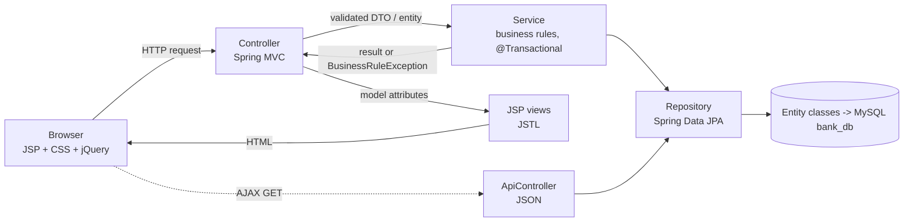
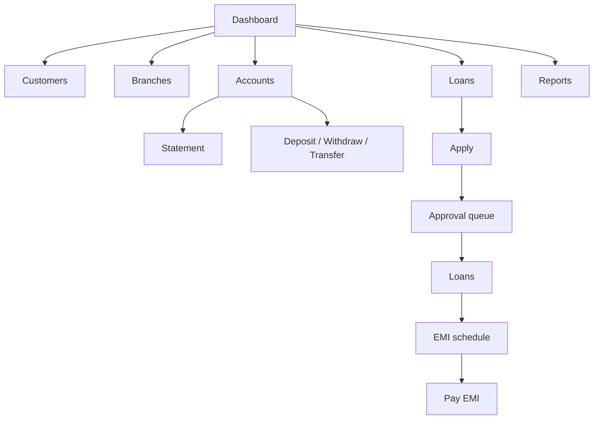

# Final Project Report - Staff Graded Assignment 2
**Building Database Applications - Banking & Loan Management System**

> HOW TO USE THIS DRAFT. Technical content below matches the code in the project zip. Items marked **[YOU: ...]** can only come from your machine or your own Assignment 1 (screenshots, real test output, commit log, your details). Please read each section and rewrite it in your own words before submitting; the assignment requires the report to be your own work. Export the final report as `RollNo_BankingLoanManagementSystem_A2.pdf`. Mermaid diagrams can be rendered at mermaid.live and pasted as images.

---

## 1. Title Page
Building Database Applications - Staff Graded Assignment 2
Full-Stack Database Application Development
Project: Banking & Loan Management System
**[YOU: name, roll number, date]**

## 2. Student Details
| Field | Value |
|---|---|
| Name | **[YOU]** |
| Roll number | **[YOU]** |
| Email | **[YOU]** |
| Course | Building Database Applications |

## 3. Selected Project Details
Project No. 9, Banking & Loan Management System (continued from Assignment 1). Minimum features: CRUD screens for customers, branches and accounts; deposit, withdrawal and fund transfer with the minimum-balance rule as transactions; loan application and approval workflow; AJAX balance lookup; EMI schedule and account statement pages. All are implemented, plus CRUD for loan types, EMI payment, a dashboard and four reports.

## 4. Abstract
**[YOU: rewrite in your own words, about 150 words.]** Points to cover: a web application for a bank's staff to manage customers, branches, accounts and loans; built with Spring Boot, JPA/Hibernate, MySQL and JSP/JSTL following MVC; money-moving operations (transfer, loan approval, EMI payment, account opening) are single database transactions with row locking; business rules enforced in the service layer; AJAX for balance and destination-account checks; tested with JUnit, Mockito, `@DataJpaTest` and MockMvc.

## 5. Summary of the Assignment 1 Database Design and Changes Made
**[YOU: paste your Assignment 1 ER summary here (tables, keys, relationships).]**

Final schema used by the application (10 tables + 1 join table). Compare it with your Assignment 1 design and fill the last column; every difference must be listed and justified (rule 2 of the assignment).

| Table | Key columns | Notes | New / changed vs A1 **[YOU]** |
|---|---|---|---|
| branch | id, ifsc_code (unique) | name, city, address, phone | |
| account_type | id, name (unique) | min_balance, interest_rate, daily_withdraw_limit | |
| customer | id, pan (unique) | full_name, email, phone, dob, monthly_income | |
| account | id, account_number (unique), branch_id, account_type_id | balance, status (ACTIVE/FROZEN/CLOSED) | |
| account_holder | account_id, customer_id | join table for the many-to-many joint-holder relationship | |
| bank_transaction | id, account_id | type, amount, balance_after, txn_time, reference_no | |
| loan_type | id, name (unique) | interest_rate, max_tenure_months, income_multiple | |
| loan_application | id, customer_id, loan_type_id, account_id | amount, tenure_months, status (PENDING/APPROVED/REJECTED) | |
| loan | id, application_id (unique) | principal, annual_rate, tenure_months, emi_amount, status | |
| emi_installment | id, loan_id | installment_no, due_date, emi_amount, principal/interest split, status | |
| employee | id, branch_id | name, designation, salary | |

**Changes made** **[YOU: complete from your comparison; examples of typical entries]:**

| Change | Reason |
|---|---|
| `unique` constraint on `loan.application_id` | Database-level guard so an application can never produce two loans, even under concurrent approvals |
| `bank_transaction.reference_no` | Links the two ledger rows of a transfer |
| `balance_after` in `bank_transaction` | Makes the statement self-contained and auditable |
| `daily_withdraw_limit` in `account_type` | Needed by the daily withdrawal rule |

## 6. System Architecture (MVC)

Request flow example, fund transfer: the browser POSTs `/transactions/transfer` -> `TransactionController` validates `TransferForm` (Bean Validation) -> `TransactionService.transfer()` opens one transaction, locks both accounts (`SELECT ... FOR UPDATE`), checks the rules, updates two balances and writes two ledger rows -> on success the controller redirects with a flash message (Post/Redirect/Get); on a rule violation a `BusinessRuleException` rolls everything back and the form is shown again with the message.

## 7. Technology Stack
| Technology | Purpose |
|---|---|
| Java 17, Maven | Language and build |
| Spring Boot 3.2 (web, data-jpa, validation) | Application framework, MVC, JPA, Bean Validation |
| Hibernate / JPA | Object-relational mapping |
| MySQL 8 + mysql-connector-j | Database and driver |
| JSP + JSTL + Spring form tags (tomcat-embed-jasper) | Server-side views |
| CSS, JavaScript, jQuery 3.7 (CDN) | Styling, client-side validation, AJAX |
| Lombok | Removes getter/setter boilerplate |
| JUnit 5, Mockito, Spring Test, H2 | Unit, repository and endpoint tests |
| Git | Version control |

## 8. Project Structure
```
banking-loan-system/
  pom.xml
  sql/seed.sql
  src/main/java/com/bank/
    BankApplication.java
    controller/  Dashboard, Customer, Branch, Account, Transaction, Loan, Report, Api
    service/     TransactionService, AccountService, LoanService
    repository/  one Spring Data repository per entity
    model/       10 entities
    dto/         CashForm, TransferForm, AccountForm, LoanApplicationForm
    exception/   BusinessRuleException, ResourceNotFoundException, GlobalExceptionHandler
    util/        EmiCalculator, PageUtil
  src/main/resources/ application.properties, static/css/style.css, static/js/app.js
  src/main/webapp/WEB-INF/jsp/ common/ customers/ branches/ accounts/ transactions/ loans/ reports/
  src/test/java/com/bank/ util/ service/ repository/ web/
```
Key files: `TransactionService` (deposit/withdraw/transfer rules), `LoanService` (apply/approve/reject/pay EMI), `EmiCalculator` (formula and schedule), `GlobalExceptionHandler` (error page), `app.js` (validation and AJAX).

## 9. Database Configuration
`src/main/resources/application.properties`:
```properties
spring.datasource.url=jdbc:mysql://localhost:3306/bank_db?createDatabaseIfNotExist=true&useSSL=false&allowPublicKeyRetrieval=true&serverTimezone=UTC
spring.datasource.username=root
spring.datasource.password=******
spring.jpa.hibernate.ddl-auto=update
spring.jpa.open-in-view=true
spring.mvc.view.prefix=/WEB-INF/jsp/
spring.mvc.view.suffix=.jsp
```
`ddl-auto=update` creates and updates tables from the entities; demo data is loaded with `sql/seed.sql`. **[YOU: screenshot of `SHOW TABLES;` in MySQL.]**

## 10. Entity Classes and Relationships
Entities (10): Branch, AccountType, Customer, Account, BankTransaction, LoanType, LoanApplication, Loan, EmiInstallment, Employee.

| # | Relationship | Mapping |
|---|---|---|
| 1 | Customer N : M Account (joint holders) | `@ManyToMany` on `Account.holders` (owner, join table `account_holder`), `mappedBy` on `Customer.accounts` |
| 2 | Branch 1 : N Account | `@ManyToOne Account.branch` |
| 3 | AccountType 1 : N Account | `@ManyToOne Account.accountType` |
| 4 | Account 1 : N BankTransaction | `@ManyToOne BankTransaction.account` |
| 5 | Customer / LoanType / Account 1 : N LoanApplication | `@ManyToOne` x3 |
| 6 | LoanApplication 1 : 1 Loan | `@OneToOne Loan.application` (unique FK) |
| 7 | Loan 1 : N EmiInstallment | `@OneToMany(mappedBy="loan", cascade=ALL)` |
| 8 | Branch 1 : N Employee | `@ManyToOne Employee.branch` |

**[YOU: insert ER diagram image (from Assignment 1, updated).]**

## 11. Data Access and Custom Queries
Besides `save / findById / findAll / delete`, the repositories define:

| # | Method | Purpose |
|---|---|---|
| 1 | `AccountRepository.findByAccountNumber` | Lookup for AJAX and transactions |
| 2 | `AccountRepository.findForUpdate` | `PESSIMISTIC_WRITE` row lock for money movement |
| 3 | `AccountRepository.search` | Account listing filtered by branch and number, paged |
| 4 | `AccountRepository.findLowBalance` | Low-balance report |
| 5 | `AccountRepository.topDepositors` | Customers ranked by total balance (join through holders) |
| 6 | `AccountRepository.branchTotals` | Branch-wise account count and deposits |
| 7 | `AccountRepository.totalDeposits` | Dashboard figure |
| 8 | `CustomerRepository.search` | Search by name or PAN, paged and sorted |
| 9 | `BranchRepository.search` | Search by name, city or IFSC |
| 10 | `BankTransactionRepository.findByAccountIdAndTxnTimeBetween` | Account statement for a date range |
| 11 | `BankTransactionRepository.sumAmount` | Today's debits (daily limit rule) |
| 12 | `BankTransactionRepository.findTop10ByOrderByTxnTimeDesc` | Dashboard recent activity |
| 13 | `EmiInstallmentRepository.findOverdue` | Overdue EMI report |
| 14 | `LoanApplicationRepository.findForUpdate` | Row lock to stop double approval |
| 15 | `LoanApplicationRepository.findByStatusOrderBy...` | Pending/approved/rejected queues |

## 12. Business Rules and Transactions
| ID | Rule | Where enforced |
|---|---|---|
| BR1 | A debit (withdrawal, transfer, EMI) may not take the balance below the account type's minimum balance | `TransactionService.checkMinimumBalance` |
| BR2 | Total withdrawals + outgoing transfers per day may not exceed the daily limit | `TransactionService.checkDailyLimit` |
| BR3 | Source and destination of a transfer must differ and both accounts must be ACTIVE | `TransactionService.transfer`, `requireActive` |
| BR4 | Amounts must be greater than zero | DTO validation + `requirePositive` |
| BR5 | Opening deposit must be at least the minimum balance | `AccountService.create` |
| BR6 | An account can be closed or deleted only with zero balance | `AccountService.update/delete` |
| BR7 | Loan amount <= income multiple x monthly income; tenure <= type maximum | `LoanService.checkEligibility` |
| BR8 | Loan account must belong to the applicant and be ACTIVE | `LoanService.apply` |
| BR9 | Only PENDING applications can be approved or rejected; a rejection needs a reason | `LoanService.approve/reject` (row lock + unique FK) |
| BR10 | EMI = P r (1+r)^n / ((1+r)^n - 1), r = annual rate / 1200 | `EmiCalculator` |

Transactions (`@Transactional`; any `BusinessRuleException` rolls back all steps):
1. **Fund transfer**: lock both accounts in account-number order (avoids deadlock), debit, credit, two ledger rows sharing a reference number.
2. **Loan approval**: lock application, create loan, generate the full EMI schedule, credit the account, write the ledger row, mark APPROVED.
3. **EMI payment**: debit the account, write the ledger row, mark the instalment PAID, close the loan after the last one.
4. **Account opening**: create account, link holders, write the opening-deposit ledger row.

## 13. URL Mapping Table
| Method | URL | Purpose |
|---|---|---|
| GET | `/` | Dashboard |
| GET | `/customers` | List, search (`q`), sort, paginate |
| GET | `/customers/new` | Blank customer form |
| GET | `/customers/{id}/edit` | Edit form (404 page if missing) |
| POST | `/customers/save` | Create or update (server validation) |
| POST | `/customers/{id}/delete` | Delete |
| GET | `/branches` | List, search, sort, paginate |
| GET | `/branches/new`, `/branches/{id}/edit` | Forms |
| POST | `/branches/save`, `/branches/{id}/delete` | Save, delete |
| GET | `/accounts` | List, filter by number/branch, sort, paginate |
| GET | `/accounts/new`, `/accounts/{id}/edit` | Forms |
| POST | `/accounts/save`, `/accounts/{id}/delete` | Open/update, delete |
| GET | `/accounts/{id}/statement` | Statement with date range, sort, pagination |
| GET | `/accounts/balance` | Balance lookup page (AJAX) |
| GET, POST | `/transactions/deposit` | Deposit form, submit |
| GET, POST | `/transactions/withdraw` | Withdrawal form, submit |
| GET, POST | `/transactions/transfer` | Transfer form, submit |
| GET | `/loans/types` | Loan type list |
| GET | `/loans/types/new`, `/loans/types/{id}/edit` | Forms |
| POST | `/loans/types/save`, `/loans/types/{id}/delete` | Save, delete |
| GET, POST | `/loans/apply` | Loan application form, submit |
| GET | `/loans/applications?status=` | Application queue by status |
| POST | `/loans/applications/{id}/approve` | Approve (transaction) |
| POST | `/loans/applications/{id}/reject` | Reject with reason |
| GET | `/loans` | Active and closed loans |
| GET | `/loans/{id}/emi` | EMI schedule |
| POST | `/loans/{id}/pay-emi` | Pay next instalment (transaction) |
| GET | `/reports/branch-totals` | Branch-wise deposits |
| GET | `/reports/top-depositors?n=` | Top-N depositors |
| GET | `/reports/overdue-emis` | Overdue instalments |
| GET | `/reports/low-balance?threshold=` | Low-balance accounts |
| GET | `/api/accounts/{no}/balance` | AJAX JSON: balance, status, available amount |
| GET | `/api/accounts/{no}/holders` | AJAX JSON: holder names, branch, status |

## 14. User Interface Pages and Page Flow
22 JSP pages share `common/header.jspf` (navigation), `footer.jspf` and `pager.jspf`: dashboard; customers (list, form); branches (list, form); accounts (list, form, statement, balance lookup); transactions (cash for deposit and withdraw, transfer); loans (types, type form, apply, applications, list, EMI schedule); reports (branch totals, top depositors, overdue EMIs, low balance); error.


**[YOU: add a screenshot of the navigation bar.]**

## 15. Client-Side Validation and Interactive Features
`app.js` validates every form with class `validate` using the browser constraint API (required, pattern, min, type) and shows messages under the fields before submitting. Forms covered: customer, branch, account opening, deposit/withdraw, transfer, loan type, loan application (7 forms). Examples: phone `[0-9]{10}`, PAN `[A-Z]{5}[0-9]{4}[A-Z]`, IFSC `[A-Z]{4}0[A-Z0-9]{6}`, amount > 0, at least one account holder.

Interactive features: (1) live EMI preview on the loan form; (2) confirmation dialogs for delete, approve and EMI payment; (3) automatic upper-casing of PAN and IFSC; (4) live balance and holder hints while filling forms; (5) a client-side table filter (`.table-filter`, available for any table).
**[YOU: screenshots of an error shown under a field and the EMI preview.]**

## 16. AJAX Features
1. **Balance lookup** (`/accounts/balance`, and under the account field of the deposit, withdraw and transfer forms): jQuery `$.getJSON` calls `GET /api/accounts/{no}/balance` and updates a `<p>` with balance, available amount above the minimum, and status; a 404 shows "Account not found".
2. **Destination account check** on the transfer form: `GET /api/accounts/{no}/holders` displays holder names, branch and status before the user submits.
**[YOU: screenshots + a browser DevTools Network tab image showing the JSON.]**

## 17. Server-Side Validation and Error Handling
- Bean Validation annotations on entities and DTOs (`@NotBlank`, `@Pattern`, `@Email`, `@Past`, `@DecimalMin`, `@Digits`...); `BindingResult` re-displays the form with a message under each field.
- Duplicate PAN, IFSC and loan-type name are checked against the database and reported as field errors.
- Rule violations (`BusinessRuleException`) are shown as a red banner on the same form; nothing is saved.
- Deleting a record that is still referenced shows a friendly flash message instead of a database error.
- `GlobalExceptionHandler` shows `error.jsp` with the right HTTP status: 404 (missing record or URL), 400, 405 and 500.
**[YOU: screenshots of a field error, a rule banner and the 404 page.]**

## 18. End-to-End Workflows
**Workflow 1 - Fund transfer.** Open Transfer -> enter source, destination (AJAX check) and amount -> submit. Success: "Transfer successful. Reference TRF...". Failure examples: same account, below minimum balance, daily limit exceeded, frozen account; balances stay unchanged. Verify in both account statements.
**Workflow 2 - Loan application to repayment.** Apply Loan (EMI preview) -> application appears as PENDING -> officer clicks Approve -> loan created, schedule generated, amount credited and shown as LOAN_DISBURSAL in the statement -> Pay next EMI debits the account and marks the instalment PAID. A second approval attempt shows "Only PENDING applications can be approved".
**[YOU: screenshots of each step.]**

## 19. Search, Navigation and Pagination
- Search/filter: customers (name or PAN), branches (name, city, IFSC), accounts (number + branch), statement (date range), loan applications (status), reports (N, threshold).
- Pagination and sorting: customers (default 5 per page), accounts (5), statement (10), branches (10); the sort column is whitelisted in `PageUtil`.
- The top navigation bar links every module.
**[YOU: screenshots.]**

## 20. Reports and Dashboard
Reports: branch-wise deposits, top-N depositors, overdue EMIs, low-balance accounts. Dashboard: customers, branches, accounts, total deposits, pending applications, active loans, overdue EMIs, today's transactions and the 10 most recent ledger entries.
**[YOU: screenshots.]**

## 21. Testing Summary and Test Cases
Run `mvn test`. **[YOU: paste the real console summary ("Tests run: N, Failures: 0") and a screenshot.]**

**Business-rule unit tests** (`TransactionServiceTest`, `LoanServiceTest`, `EmiCalculatorTest`): minimum balance rejection and boundary, daily limit, same-account transfer, non-positive amount, frozen account, duplicate approval, rejection of a non-pending application, income cap, EMI value 8884.88 for 100000 @ 12% / 12 months, schedule repays principal exactly.

**Query tests** (`QueryTest`, H2): `findLowBalance`, `branchTotals`, `topDepositors`.

**Endpoint tests** (`EndpointTest`, MockMvc): dashboard 200, balance API 200 JSON / 404, deposit POST 302 and balance updated, withdrawal violating minimum balance shows an error and keeps the balance, invalid customer form returns field errors, missing customer gives 404 error page. **[YOU: for the "request and response" evidence, also run the app and paste real responses, e.g.]**
```
curl -i http://localhost:8080/api/accounts/AC1000000001/balance
curl -i http://localhost:8080/api/accounts/DOESNOTEXIST/balance
curl -i http://localhost:8080/customers/99999/edit
```

**Functional test cases** (fill "Actual" and "Status" after running them on your app with the seed data):

| ID | Description | Input | Expected | Actual | Status |
|---|---|---|---|---|---|
| TC01 | Create customer | Valid data | Saved, success message, appears in list | **[YOU]** | |
| TC02 | Customer validation | Phone `123`, PAN `abc` | Client-side errors; no submit | | |
| TC03 | Duplicate PAN | PAN `ABCDE1234F` | "This PAN is already registered" | | |
| TC04 | Open account below minimum | SAVINGS, deposit 500 | Rule banner; no account | | |
| TC05 | Deposit | AC1000000001, 1000 | Balance +1000, ledger row | | |
| TC06 | Withdraw below minimum | Balance 5500 account, 5000 | "Minimum balance rule..."; balance same | | |
| TC07 | Daily limit | Withdraw 40000 then 20000 on SAVINGS | Second fails with daily-limit message | | |
| TC08 | Transfer success | AC1000000002 -> AC1000000004, 1000 | Both balances change, one reference on both rows | | |
| TC09 | Transfer same account | Same number twice | "must be different" | | |
| TC10 | Transfer to unknown account | AC0000000000 | "does not exist"; AJAX shows "Account not found" | | |
| TC11 | Loan over income cap | Meera (income 30000), Personal Loan, 400000 | "exceeds the eligible limit" | | |
| TC12 | Approve loan | Pending application #2 | Loan + schedule created, account credited | | |
| TC13 | Approve twice | Same application again | "Only PENDING applications can be approved" | | |
| TC14 | Pay EMI | Loan #1 | Instalment PAID, account debited | | |
| TC15 | Missing record | `/customers/99999/edit` | 404 error page | | |
| TC16 | Delete customer with account | Customer holding an account | Friendly error; record kept | | |

## 22. Version Control History
**[YOU: paste `git log --oneline` and a screenshot of the repository. See GIT_COMMITS.md for a suggested sequence; make real commits as you work.]**

## 23. Application Screenshots
**[YOU: screenshots from your own running app: dashboard, each CRUD list and form, validation errors, statement, transfer, loan approval, EMI schedule, reports, error page.]**

## 24. User Guide
1. Install JDK 17+, Maven and MySQL; set the DB username/password in `application.properties`.
2. `mvn spring-boot:run`; stop; `mysql -u root -p < sql/seed.sql`; start again; open http://localhost:8080/.
3. Use the top menu: Customers, Branches, Accounts (open accounts, view statements), Deposit/Withdraw/Transfer, Apply Loan, Approvals, Loans (EMI schedule, pay EMI), Loan Types, Reports.

## 25. Conclusion
**[YOU: 4 to 6 sentences in your own words: what was built, what you learned about layering, transactions, locking and testing.]**

## 26. Future Enhancements
Login with Spring Security and role-based access (teller, loan officer, manager); interest accrual jobs; automatic late fees on overdue EMIs; PDF statements; REST API with tokens; audit log; email/SMS notifications.

## 27. References
Spring Boot reference documentation; Spring Data JPA reference; Hibernate ORM user guide; Jakarta Bean Validation; JSTL documentation; MySQL 8 reference manual; course material. **[YOU: add exact URLs and anything else you used.]**
